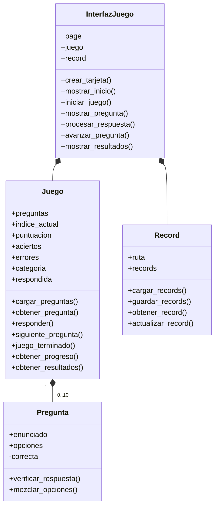

# 🧠 QuizMaster

## 📌 Descripción

QuizMaster es una aplicación gráfica interactiva de preguntas
y respuestas desarrollada en Python utilizando la biblioteca
Flet y programación orientada a objetos.

El proyecto permite evaluar los conocimientos del usuario
mediante diferentes categorías, asignar puntuaciones,
mostrar resultados y guardar récords personales.

## 🎯 Objetivo

Demostrar el funcionamiento de las interfaces gráficas
en Python, la creación de componentes visuales y el
manejo de eventos producidos por el usuario.

## 🚀 Características

- Interfaz gráfica moderna en modo oscuro.
- Cuatro categorías de conocimiento.
- Banco de 40 preguntas.
- Diez preguntas por partida.
- Preguntas y respuestas en orden aleatorio.
- Sistema de puntuación.
- Barra de progreso.
- Validación de respuestas.
- Retroalimentación mediante colores.
- Estadísticas al finalizar la partida.
- Récords personales almacenados en JSON.
- Opción para volver a jugar.

## 📚 Investigación sobre Flet

### 1. ¿Qué es Flet y cuál es su propósito?

Flet es una biblioteca de código abierto que permite
construir interfaces gráficas multiplataforma con Python.

Utiliza Flutter para representar sus componentes visuales.
Su propósito es facilitar el desarrollo de aplicaciones
gráficas sin requerir conocimientos de desarrollo frontend.

### 2. ¿Qué aplicaciones permite desarrollar?

- Aplicaciones de escritorio.
- Aplicaciones web.
- Aplicaciones móviles.
- Sistemas administrativos.
- Aplicaciones educativas.
- Formularios y juegos de preguntas.

### 3. Instalación y requisitos

Flet requiere Python 3.10 o superior y un sistema
operativo compatible.

Para este proyecto se utilizó:

- Python 3.13.14.
- Flet 1.1.2.
- Visual Studio Code.
- Windows.

Instalación de Flet:

    pip install "flet[all]==1.1.2"

### 4. Principales componentes gráficos

| Componente | Función |
|---|---|
| Page | Representa la página principal. |
| Text | Muestra información textual. |
| Button | Permite ejecutar acciones. |
| Container | Agrupa y personaliza elementos. |
| Row | Organiza elementos horizontalmente. |
| Column | Organiza elementos verticalmente. |
| Icon | Muestra iconos gráficos. |
| ProgressBar | Representa el progreso. |
| Divider | Separa componentes visuales. |
| TextField | Permite introducir información. |

### 5. Manejo de eventos

Flet permite asociar funciones o métodos a eventos
producidos por los usuarios.

Algunos eventos son:

- on_click: detecta clics.
- on_change: detecta cambios de valor.
- on_hover: detecta la interacción del cursor.
- on_submit: detecta la confirmación de una entrada.
- on_keyboard_event: detecta pulsaciones del teclado.

QuizMaster utiliza principalmente on_click para
seleccionar categorías, responder preguntas y
navegar entre las pantallas.

### 6. Comparación entre Flet y Tkinter

| Característica | Flet | Tkinter |
|---|---|---|
| Diseño | Moderno | Tradicional |
| Instalación | Externa | Incluido habitualmente en Python |
| Escritorio | Sí | Sí |
| Web | Sí | No de forma nativa |
| Aplicaciones móviles | Sí | No de forma nativa |
| Programación orientada a objetos | Sí | Sí |
| Consumo de recursos | Generalmente mayor | Generalmente menor |
| Manejo de eventos | Sí | Sí |

Flet ofrece componentes modernos, personalización
visual y desarrollo multiplataforma.

Entre sus limitaciones se encuentran la instalación
de dependencias adicionales y un consumo de recursos
que puede ser superior al de Tkinter.

## 📂 Estructura del proyecto

    QuizMaster/
    ├── main.py
    ├── interfaz.py
    ├── juego.py
    ├── pregunta.py
    ├── record.py
    ├── preguntas.json
    ├── requirements.txt
    ├── README.md
    ├── .gitignore
    └── evidencia/
        ├── inicio.png
        ├── pregunta.png
        ├── respuesta.png
        └── resultados.png

El archivo records.json se genera automáticamente
cuando el usuario consigue un récord personal.

## ⚙️ Instalación y ejecución

### 1. Descargar el repositorio

Descargar el proyecto desde GitHub mediante
la opción Code > Download ZIP o clonarlo con Git.

### 2. Crear un entorno virtual

    python -m venv .venv

### 3. Activar el entorno virtual en Windows CMD

    .venv\Scripts\activate.bat

### 4. Instalar las dependencias

    python -m pip install -r requirements.txt

### 5. Ejecutar la aplicación

    python main.py

## 🎮 Funcionamiento del juego

1. El usuario inicia QuizMaster.
2. Selecciona una de las cuatro categorías.
3. El sistema carga diez preguntas.
4. Las preguntas y sus opciones se mezclan.
5. El jugador selecciona una respuesta.
6. El sistema valida la opción seleccionada.
7. Si es correcta, se asignan diez puntos.
8. Se actualiza la interfaz gráfica.
9. El jugador continúa con la siguiente pregunta.
10. Al finalizar, se muestran los resultados.
11. Si supera su récord, se guarda automáticamente.

## 🖥️ Funcionamiento de la interfaz gráfica

### Creación de la ventana

La aplicación comienza desde main.py mediante
ft.run(main), que inicializa la página principal.

### Creación de componentes

La clase InterfazJuego utiliza objetos de Flet
como Text, Container, Icon, Row, Column y Button.

### Evento implementado

El evento on_click detecta las interacciones
del usuario con las tarjetas y botones.

### Procesamiento del evento

El método procesar_respuesta() recibe el índice
de la opción seleccionada y solicita a la clase
Juego que valide la respuesta.

### Actualización de la interfaz

Después de responder, se modifican los colores
de las opciones, la puntuación, el mensaje y
la barra de progreso.

Finalmente, se ejecuta page.update() para
reflejar los cambios realizados.

## 🧩 Programación orientada a objetos

Flet permite trabajar con clases y objetos.
QuizMaster implementa cuatro clases principales.

### Clase Pregunta

Responsable de representar cada pregunta.

- Almacena el enunciado.
- Almacena las opciones.
- Encapsula el índice de la respuesta correcta.
- Mezcla las opciones.
- Verifica las respuestas.

### Clase Juego

Responsable de administrar la lógica del juego.

- Carga las preguntas.
- Controla el avance de la partida.
- Administra la puntuación.
- Registra respuestas correctas e incorrectas.
- Genera los resultados.

### Clase InterfazJuego

Responsable de la presentación gráfica.

- Configura la ventana principal.
- Crea las tarjetas de categorías.
- Muestra las preguntas.
- Procesa eventos.
- Actualiza los componentes.
- Muestra los resultados.

### Clase Record

Responsable del almacenamiento persistente.

- Carga los récords personales.
- Consulta la mejor puntuación.
- Actualiza los récords.
- Guarda los datos en formato JSON.

### Principios de POO aplicados

- Clases y objetos.
- Encapsulamiento.
- Abstracción.
- Composición.
- Constructores.
- Métodos y atributos.
- Separación de responsabilidades.

## 📊 Diagrama de clases UML

## 📸 Evidencias

### Menú principal

### Pantalla de preguntas

### Validación de respuestas

### Resultados finales

## 🛠️ Tecnologías utilizadas

- Python.
- Flet.
- JSON.
- Visual Studio Code.
- Git.
- GitHub.

## 📖 Fuentes consultadas

- [Documentación oficial de Flet](https://flet.dev/docs/)
- [Instalación de Flet](https://flet.dev/docs/getting-started/installation/)
- [Creación de aplicaciones y eventos](https://flet.dev/docs/getting-started/create-flet-app/)
- [Ejecución de aplicaciones](https://flet.dev/docs/getting-started/running-app/)
- [Repositorio oficial de Flet](https://github.com/flet-dev/flet)
- [Documentación de Tkinter](https://docs.python.org/3/library/tkinter.html)

## 📝 Conclusión

El desarrollo de QuizMaster permitió comprender
la creación de interfaces gráficas con Flet,
el manejo de eventos y la integración de la
programación orientada a objetos con componentes
visuales interactivos.

La aplicación demuestra cómo una biblioteca
gráfica de Python puede utilizarse para crear
soluciones funcionales, organizadas e interactivas.

---
QuizMaster v1.0 | Proyecto académico
